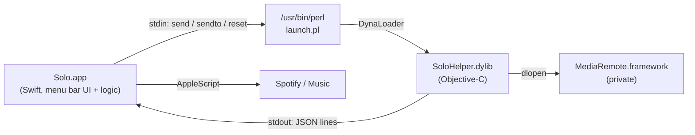

# Solo

A macOS menu bar app that makes sure only one thing plays at a time.

When a new app starts playing audio, Solo pauses the one that was playing before. When the new app pauses (or stops), Solo resumes the app it interrupted. Think Spotify → YouTube in a browser → back to Spotify, without touching a single play button.

## How it works

Solo watches the system-wide Now Playing state through the private `MediaRemote` framework and keeps a stack of the apps it paused.

- **Play events:** when a different app becomes the Now Playing app and starts playing, the previous app is paused and pushed onto the stack.
- **Pause events:** when the current app stops, the most recently paused app is resumed (after a 1 s debounce, so seeking or buffering doesn't trigger a resume).
- **Manual override:** if you resume something Solo paused yourself, it is dropped from the stack.

Pausing and resuming works two ways:

- **Spotify and Music:** controlled via AppleScript, which works while they are in the background.
- **Any other app (experimental):** Solo temporarily overrides the system's elected Now Playing app via MediaRemote, sends the command, then restores the previous election. Off by default; toggle it in the menu.

### Architecture



Since macOS 15.4, `mediaremoted` only serves Apple-signed clients. The helper dylib is therefore loaded into `/usr/bin/perl` (Apple-signed) through `DynaLoader`, and talks to the Swift app over stdin/stdout. If the helper dies, Solo restarts it, and the helper clears any Now Playing override on exit.

## Requirements

- macOS 14 or later
- Xcode command line tools (`clang`, `swiftc`)

## Build and install

```sh
./build.sh             # builds build/Solo.app (ad-hoc signed)
./build.sh --install   # also replaces /Applications/Solo.app and relaunches it
```

On first use, macOS asks for permission to control Spotify and Music (Automation). Solo has no Dock icon; it lives in the menu bar.

## Menu

- **Now playing / Paused by Solo:** current state and the resume stack
- **Enabled:** turn Solo on or off
- **Experimental: target any app:** use the MediaRemote override for apps without AppleScript support
- **Forget paused apps:** clear the resume stack
- **Reset Now Playing override:** clear a stuck override
- **Recent events:** the last events; the full log is at `~/Library/Logs/Solo.log`

## Project layout

| Path | Purpose |
| --- | --- |
| `app/main.swift` | Menu bar app, coordination logic, AppleScript control |
| `helper/SoloHelper.m` | MediaRemote bridge (state events, commands, override) |
| `helper/launch.pl` | Loads the helper dylib into Apple-signed perl |
| `build.sh` | Build, sign, optionally install |

## Caveats

`MediaRemote` is a private API and can change or break with any macOS release. Solo is not App Store compatible.
